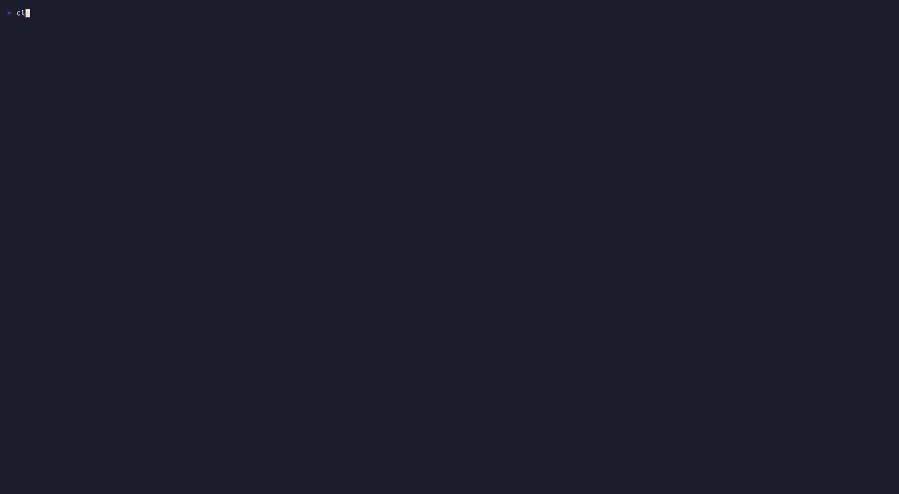

# Fault Lacquer



*Three commands fail and crack their tiles; after the fixes, two tiles are mended with gold seams and the build stays broken.* [Watch the MP4](https://github.com/ccdwyer/claude-mods/raw/main/media/fault-lacquer.mp4)

Kintsugi for your Claude Code session. Every operation that fails (a test run, a type-check, an Edit whose text wasn't found, a fetch that 404s) becomes a glossy indigo lacquer tile, and the failure cracks it: braille fracture lines race out from an impact point while the tile shakes. When a later run of the same operation succeeds, the cracks fill with gold. A bright seam sweeps along each fracture, then glints for a moment. The tile is mended and more beautiful than before. Failures nobody fixed stay broken.

- **Band above the prompt:** a row of mini-tiles (white cracks for broken, gold for mended) and the tally, e.g. `◈ 7 cracks · 5 repaired in gold · 2 still broken`. It stacks with other mods' bands.
- **`/kintsugi`:** opens the full wall in a pane, newest tiles first, each labelled with the operation and its counts (`×` failures, `◆` repairs), plus a list of what is still broken.
- **`/kintsugi band off|on`**, **`/kintsugi clear`**, and **`/kintsugi gallery`** (cracks and repairs across your last 200 sessions).

An operation is keyed by tool and target: the exact shell command (so `cd web && npm test` and `cd api && npm test` are different tiles; the label shows the short form), the file for an edit, the URL for a fetch, the query or pattern and path for a search, and every plain argument for an MCP tool (issue 1 and issue 2 are different tiles). Successes only matter for an operation that already broke. Interruptions, refusals, edits held for review, and shell runs that were backgrounded or timed out prove nothing either way. A fetch that returns an HTTP error (4xx/5xx) counts as a failure. `/kintsugi clear` resets the wall and this session's counts; the band and pane count every crack and repair this session, even ones whose tiles have rolled off the 48-tile wall.

The animation runs at about 30fps only while a crack is growing or gold is sweeping. Otherwise nothing is repainted. On the desktop surface (no Raster) the band and pane fall back to text.

## Install

```
/plugin marketplace add ccdwyer/claude-mods
/plugin install fault-lacquer@ccdwyer-mods
/reload-plugins
```

## Develop

```
claude plugin validate .
claude plugin test .
```

## What it hooks

Events this mod hooks, as `claude plugin validate` reads the module:

- `session.start`: registers `/kintsugi` and starts the frame clock
- `session.end`: adds the session's summary to the lifetime gallery
- `command.run` for `/kintsugi`
- `tool.call`: after the call runs, notes whether it failed or succeeded
- `ui.render` for `AbovePrompt` (the band) and for its own `Pane` (the wall)

Engine calls it makes: `$.clock.every`, `$.command.register`, `$.state.get`, `$.state.set`, `$.store.get`, `$.store.set`, `$.ui.blit`, `$.ui.invalidate`, `$.ui.open`, `$.ui.resolve`.

A `tool.call` hook sits in the middle of every tool call: it can see the call, refuse it, or add context to its result. This mod only reads whether the call failed; it never refuses or changes a call.

## Privacy

It runs entirely on your machine. It sends nothing over the network. It looks only at whether each tool call failed or succeeded and at the call's command, file path or URL, which it uses to label tiles. It keeps the session's wall in Claude Code's session state and, at the end of a session, a small summary (counts and the label of the most-failed operation) in Claude Code's local plugin store.

The mod collects no analytics or telemetry, and its author receives no data from it.

Full policy: [PRIVACY.md](PRIVACY.md).

## License

MIT
